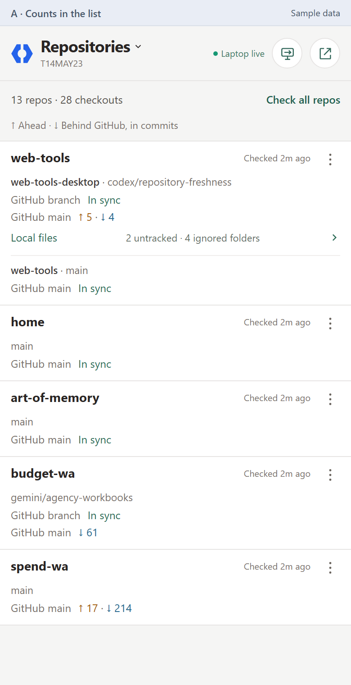
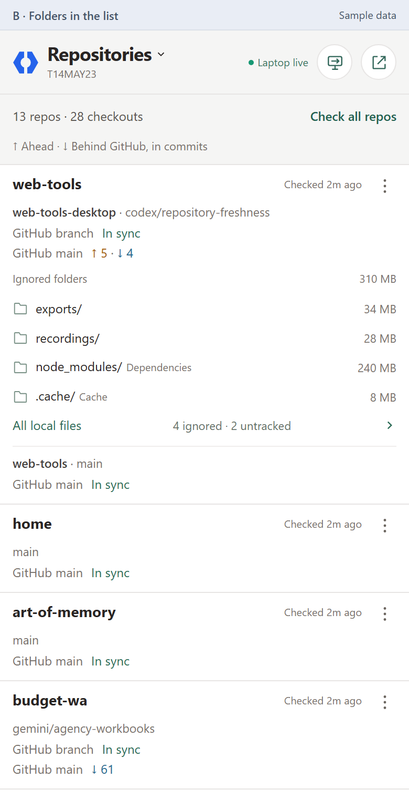
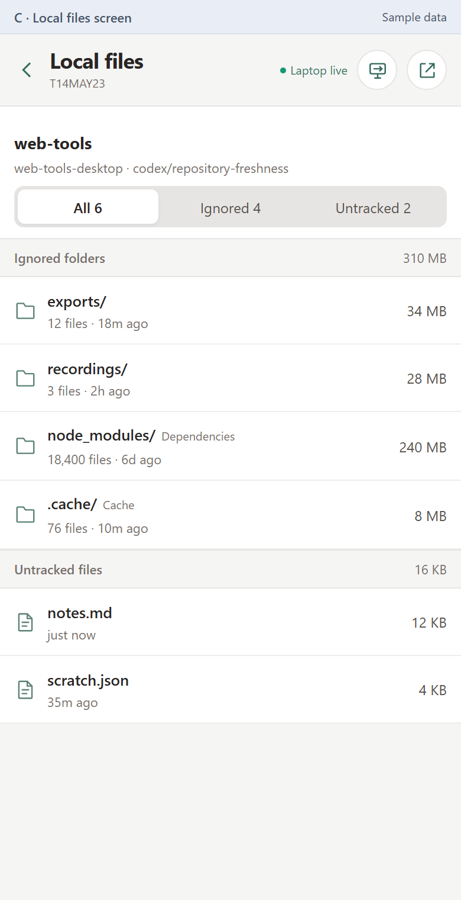
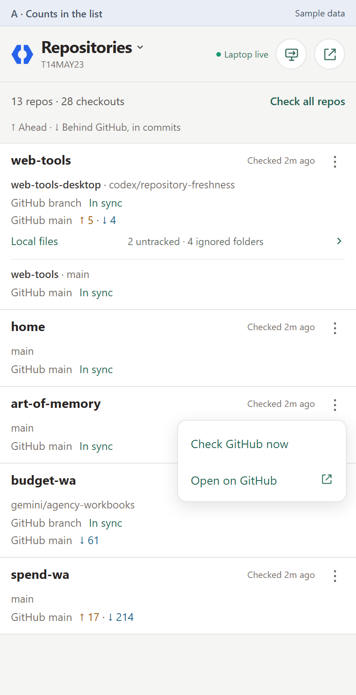

# Repository local-files mockups

Design snapshot, November 3, 2026. These screenshots compare ways to show ignored
and untracked material in the phone companion. All folder figures and commit
counts are illustrative. The installed app is unchanged by these previews.

[Open the browser gallery](https://mehrlander.github.io/web-tools/pages/toss-render.html#gh=mehrlander/web-tools@codex/repository-mockups:desktop/mockups/repository-local-files/index.html)

| View | Placement |
| --- | --- |
| A | Compact local-file counts beneath a checkout. |
| B | Ignored folder names and sizes directly in the repository list. |
| C | A separate inventory reached from A or B. |
| Menu | A vertical three-dot trigger with two plain actions. |

The proposed combination is A for the overview, opening C for inspection.

## A: Counts in the list

## B: Folders in the list

## C: Local files screen

## Simple menu

The editable layout is in [prototype.html](prototype.html), and the shared
illustrative cases are in [model.json](model.json).
