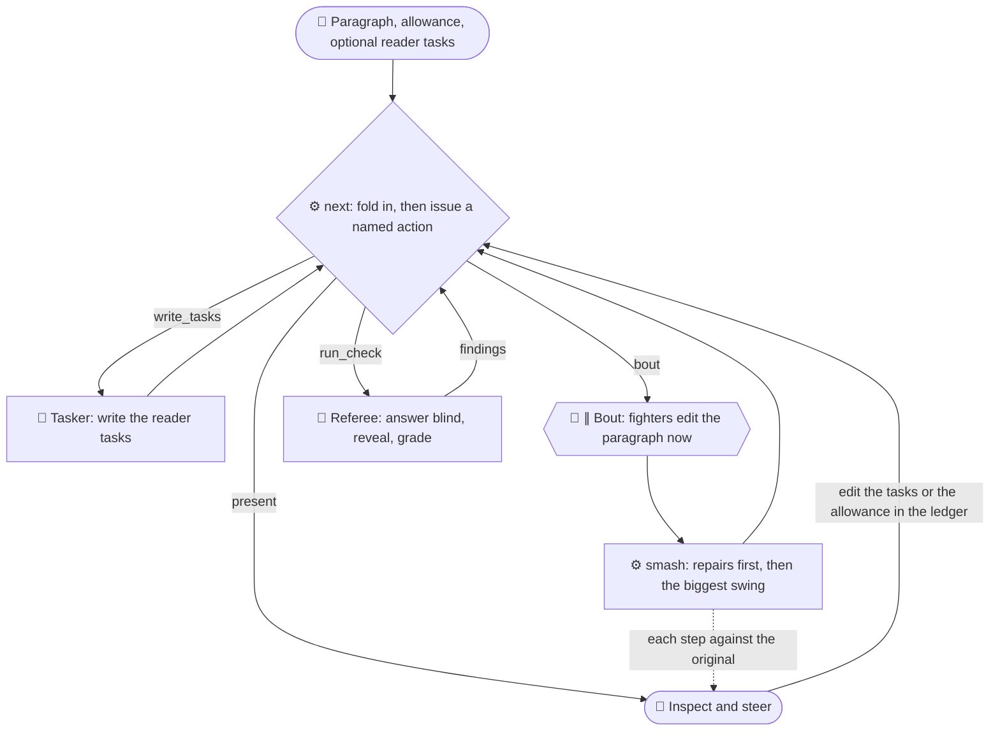

# Reduction swarm

A test bed for shortening a passage by rounds of readers who add to a shared ledger, with a harvest per round. [`roles.md`](roles.md) holds the briefs, [`swarm.py`](swarm.py) the ledger mechanics, and [`pages/swarm.html`](../../pages/swarm.html) shows a run: the rounds, the harvest with a word diff against the round before, the ledger by reader, and each payload item across rounds. Each run lives in `runs/<slug>/`.

## A run

```bash
python3 python/swarm/swarm.py init python/swarm/runs/<slug> <file> <first-line> <last-line> --title "<title>"
```

Then, for each round `N`:

1. For each role, `python3 python/swarm/swarm.py context python/swarm/runs/<slug> N <role>`, and start one Agent per role, in parallel, told to read its context file and follow it. Round 1 takes `distiller`, `tactician` and `drafter`; later rounds take `challenger` and `builder`.
2. `python3 python/swarm/swarm.py merge python/swarm/runs/<slug> N`.
3. `context … N harvester`, one Agent, then `python3 python/swarm/swarm.py harvest python/swarm/runs/<slug> N`.

Commit and push the run's `ledger.json` after each round; it holds every entry, vote and harvest, and the rest of the run directory is ignored scratch. The page follows it: `?src=mehrlander/web-tools@<branch>:python/swarm/runs/<slug>/ledger.json`, with ↻ to re-read. `swarm.py status` prints the same rounds as text, and `swarm.py gz` the ledger as a `#gz=` payload for a run with no commit.

## An edit ladder

[`ladder.py`](ladder.py) runs the other shape: single edits per paragraph, each judged on its own, then ordered from safest to boldest so a reader can swipe from the original toward the shortest version and see where the risk begins. Green is low-hanging fruit, yellow is where a reader feels the pinch, red is full caveman.

```bash
python3 python/swarm/ladder.py init python/swarm/runs/<slug> <file> <first-line> <last-line>
```

1. `context … trimmer`, `pincher` and `caveman`, one Agent each, in parallel; then `ladder.py merge python/swarm/runs/<slug> edits`.
2. `context … judge-a` and `judge-b`, one Agent each, in parallel; then `merge … ratings`.
3. `ladder.py path python/swarm/runs/<slug>` orders the passage's edits by tier (the warier judge decides it), then confidence, then words saved, and adds them in turn. An edit must leave the passage shorter. One that overlaps steps already taken replaces them when it sits in a riskier tier than all of them; otherwise it is set aside as an alternative.

A judge may also mark an edit **brilliancy** (two ideas joined into one phrase) or **brutality** (a drastic cut the paragraph turns out not to need).

## A bold run

`ladder.py init … --bold` starts a ladder that reads before it shortens, with briefs in [`bold.md`](bold.md) and, in every one, the Qualified writing rules and the owner's writing peeves (the `writing` rows of [`skills/peeves/peeves.csv`](../../skills/peeves/peeves.csv)). An idea or edit that fixes a peeve names it, and a judge counts one that introduces a peeve as losing clarity:

1. `context … reader`, one Agent: a passage reading (`reading.json`, the `passage-reading` skill's format), the problems it finds (a term used before it is introduced, one thing under several names, a missing connection, a shaky premise) and repairs for them; then `merge … repairs`.
2. `context … scout-<lens>` for each lens in `bold.md`, one Agent each, in parallel; then `merge … ideas`.
3. `context … builder-<name>` for each builder, in parallel; then `merge … edits`. An architect's edit rewrites the whole passage and stands beside the path as an alternative; an editor's edit may replace whole paragraphs. A scout's draft of the whole passage, or of all of it below the heading, joins the architects' as an alternative, so the judges rate the boldest drafts even when no builder took them up.
4. `context … judge-<x>`, in parallel; then `merge … ratings` and `path`.

The path starts with the repairs (blue), then runs green, yellow and red across the whole passage. Here a green edit that no judge says loses clarity joins the path even when it adds words; a yellow or red one must still shorten the passage. The page's Ideas tab shows what the reader found and every scout's ideas, marked where an edit was built on them.

## A dome

[`dome.py`](dome.py) puts one paragraph in front of bouts of fighters, with briefs in [`dome.md`](dome.md). Every fighter in a bout edits the paragraph as the last bout left it, with the original in view, and all of the bout's edits land on that one text, so the page reads as one paragraph changing edit by edit, each step shown against the original. Reader tasks hold the run to the original's core: questions a reader with only the paragraph must be able to answer, each with the facts an answer needs. A referee answers them blind after every bout, and a task that fails becomes a finding the next bout's fighters see. [The reduction-panel skill](../../skills/reduction-panel/SKILL.md) ends on the same gate: behavior, not review, decides what was lost.

```bash
python3 python/swarm/dome.py init python/swarm/runs/<slug> <file> <first-line> <last-line> --title "<title>" --about "<what the paragraph is>" --bouts 3 --fighters cutter,fuser,slugger
```

Then run `dome.py next python/swarm/runs/<slug>`, start the agents it prints, one each and in parallel, each told to read its context file and follow it, and run `next` again, until it prints `ready for review`. `next` is the coordinator: it folds in what the last action's agents wrote (smashing a bout, recording a check), decides the next action, writes its agents' context files, and stops the run when the allowance of bouts is spent or a bout saves no words while every task passes. The result is the shortest text on which every task passes. `dome.py`'s docstring lists the actions; `--tasks <file>` supplies the tasks in place of a tasker, and `next --force` smashes a bout without a fighter that never wrote. Commit the ledger after each action to follow the run on the page, whose Reader tasks tab shows each question's check on the original and after each bout.



The smash lands a bout's repairs first, then the rest biggest swing first (the most words claimed, then the most saved). An edit whose words are no longer there exactly once, or that overlaps words its bout already wrote, is knocked out. [`node/test/dome-loop.test.mjs`](../../node/test/dome-loop.test.mjs) runs the loop end to end with canned agents.
