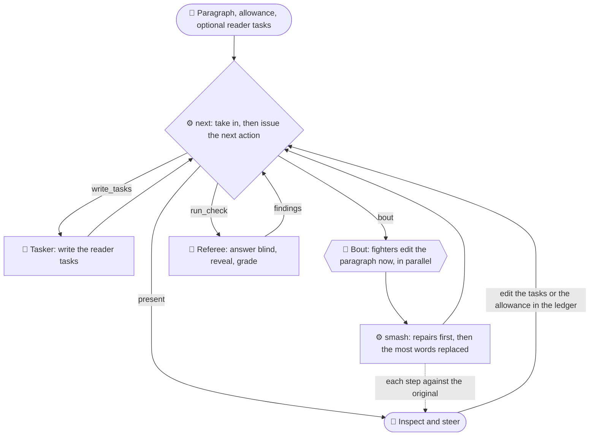

# Reduction swarm

Four ways to shorten one real passage with model agents, for a session testing how far a passage can shrink and what a reader loses. Each run has a directory, `<run>` below, normally `python/swarm/runs/<slug>`. Its record is `<run>/ledger.json`, one JSON file holding everything the agents wrote and each version of the passage, which [`pages/swarm.html`](../../pages/swarm.html) shows at `?src=mehrlander/web-tools@<branch>:python/swarm/runs/<slug>/ledger.json` (↻ re-reads it). Commit the ledger after each step to follow a run on the page; the rest of a run directory is git-ignored scratch. In every step below, start one agent per context file (the brief a `context` or `next` command writes), in parallel, each told to read its file and follow it. Below, "a reader" is a person reading the passage, and an agent is named by its role, as in the `reader` agent.

## Rounds

[`swarm.py`](swarm.py) runs rounds of agents, with briefs in [`roles.md`](roles.md). In each round the agents add entries to the ledger, and a harvester agent assembles the round's shorter version, its harvest.

```bash
python3 python/swarm/swarm.py init <run> <file> <first-line> <last-line> --title "<title>"
```

Then, for each round `N`:

1. `swarm.py context <run> N <role>` for each role. Round 1 takes the `distiller`, who names the facts a reader must keep, the `tactician`, who proposes structural moves, and the `drafter`, who drafts shorter wording. Later rounds take the `challenger`, who rewrites the whole passage shorter, and the `builder`, who combines drafts and votes on entries.
2. `swarm.py merge <run> N`.
3. `swarm.py context <run> N harvester`, then `swarm.py harvest <run> N`.

`swarm.py status <run>` prints the rounds as text, and `swarm.py gz <run>` prints the ledger gzipped into a page address (a `#gz=` link), which shows a run with no commit.

## An edit ladder

[`ladder.py`](ladder.py) collects single edits per paragraph, has judges rate each one, and orders them from safest to boldest; on the page a reader swipes from the original toward the shortest version and sees where the risk begins. Each edit gets one of three tiers. Green loses a reader nothing. Yellow leaves a reader acting the same but thins a nuance, a reason or the flow. Red, which `roles.md` calls full caveman, keeps the facts in clipped fragments or risks a reader acting differently.

```bash
python3 python/swarm/ladder.py init <run> <file> <first-line> <last-line>
```

1. `ladder.py context <run> <role>` for `trimmer`, `pincher` and `caveman`, the proposers of green, yellow and red edits; then `ladder.py merge <run> edits`.
2. `ladder.py context <run> judge-a` and `judge-b`; then `ladder.py merge <run> ratings`.
3. `ladder.py path <run>` builds the path, the sequence of edits a reader swipes through: it orders the edits by tier (the warier judge's), then the judges' confidence (0 to 100) that a reader acts as before, then words saved, and applies them in turn. An edit must leave the passage shorter. An edit that overlaps steps already taken replaces those steps when its tier is riskier than all of theirs; otherwise the edit is kept aside as an alternative.

A judge may give an edit one of two honours: brilliancy, for joining two ideas in one phrase, or brutality, for a drastic cut the paragraph turns out not to need.

## A bold run

`ladder.py init <run> <file> <first-line> <last-line> --bold` starts a ladder that reads the passage before anyone shortens it, with briefs in [`bold.md`](bold.md). Every brief includes the [Qualified writing rules](../../docs/QUALIFIED-WRITING.md) and the owner's writing peeves (the `writing` rows of [`skills/peeves/peeves.csv`](../../skills/peeves/peeves.csv)). An idea or edit that fixes a peeve names it, and a judge counts one that introduces a peeve as losing clarity.

1. `ladder.py context <run> reader`: the `reader` agent writes a passage reading (`reading.json`, in the [passage-reading skill](../../skills/passage-reading/SKILL.md)'s format), the problems it finds (a term used before it is introduced, one thing under several names, a missing connection, a shaky premise) and repairs for them; then `ladder.py merge <run> repairs`.
2. `ladder.py context <run> scout-<lens>` for each lens in `bold.md`: a scout looks at the passage through one lens, such as merging two paragraphs or cutting reasons, and proposes ideas; then `ladder.py merge <run> ideas`.
3. `ladder.py context <run> builder-<name>` for each builder in `bold.md`: builders turn the strongest ideas into edits. Three architects (`architect-bold`, `architect-clear`, `architect-balanced`) each rewrite the whole passage, and each rewrite stands beside the path as an alternative; four editors (`editor-a` to `editor-d`) each take two paragraphs, and an editor's edit may replace whole paragraphs. A scout's draft of the whole passage, or of everything after the passage's opening heading line, joins the architects' rewrites, and the judges rate it whether or not a builder took it up. Then `ladder.py merge <run> edits`.
4. `ladder.py context <run> judge-<x>` for each judge, who rates every repair and edit; then `ladder.py merge <run> ratings` and `ladder.py path <run>`.

The path starts with the repairs (blue), then runs green, yellow and red across the whole passage. A green edit that no judge says loses clarity joins the path even when it adds words; a yellow or red edit must still shorten the passage. The page's Ideas tab shows what the reader found and every scout's ideas, marked where an edit was built on them.

## A dome

A dome is a run on one paragraph in which every agent's edits land on the same text. [`dome.py`](dome.py) runs it, with briefs in [`dome.md`](dome.md). Agents called fighters edit it in bouts, the dome's rounds, each fighter with a temperament from `dome.md` that says how it shortens (`cutter` deletes, `fuser` joins clauses and `slugger` rewrites a sentence; the others are `qualifier`, `plain`, `reorder`, `caveman`, `restorer`, `fixer`, `premise` and `peever`). Each fighter in a bout edits the paragraph as the last bout left it, with the original in view, and may spend one edit on a repair: a complaint that the paragraph lost something the original said, with the words that restore it. All of the bout's edits land on that one text; the page shows one paragraph changing edit by edit, each step against the original. Reader tasks check that the run keeps the original's meaning: questions a reader with only the paragraph must be able to answer, each with the facts an answer needs. A tasker agent writes them at the start. After every bout a referee agent answers them blind, then sees the expected facts and grades its answers; a task that fails goes into the next bout's briefs as a finding.

```bash
python3 python/swarm/dome.py init <run> <file> <first-line> <last-line> --title "<title>" --about "<what the paragraph is>" --bouts 3 --fighters cutter,fuser,slugger
```

Then run `dome.py next <run>`, start the agents it prints, and run `dome.py next <run>` again, until it prints `ready for review`. `dome.py next` is the coordinator: it takes in what the last action's agents wrote, decides the next action (`write_tasks`, `run_check`, `bout`, or `present`, which ends the run), and writes its agents' context files. It presents the result when the run's allowance, the number of bouts `--bouts` sets and the ledger keeps, is spent, or when a bout saves no words and every task passes. The result is the shortest text on which every task passes. `--tasks <file>` supplies the tasks in place of the tasker, and `dome.py next <run> --force` lands a bout whose fighters have not all written. The page's Reader tasks tab shows each question's check on the original and after each bout.

Landing a bout, the smash (`dome.py smash`, which `next` runs), applies its repairs first, then its other edits biggest first: the most words replaced, then the most saved. An edit whose words no longer appear exactly once in the paragraph, or that overlaps words its bout already wrote, is dropped. [`node/test/dome-loop.test.mjs`](../../node/test/dome-loop.test.mjs) runs the loop end to end with prewritten agent output in place of agents.


