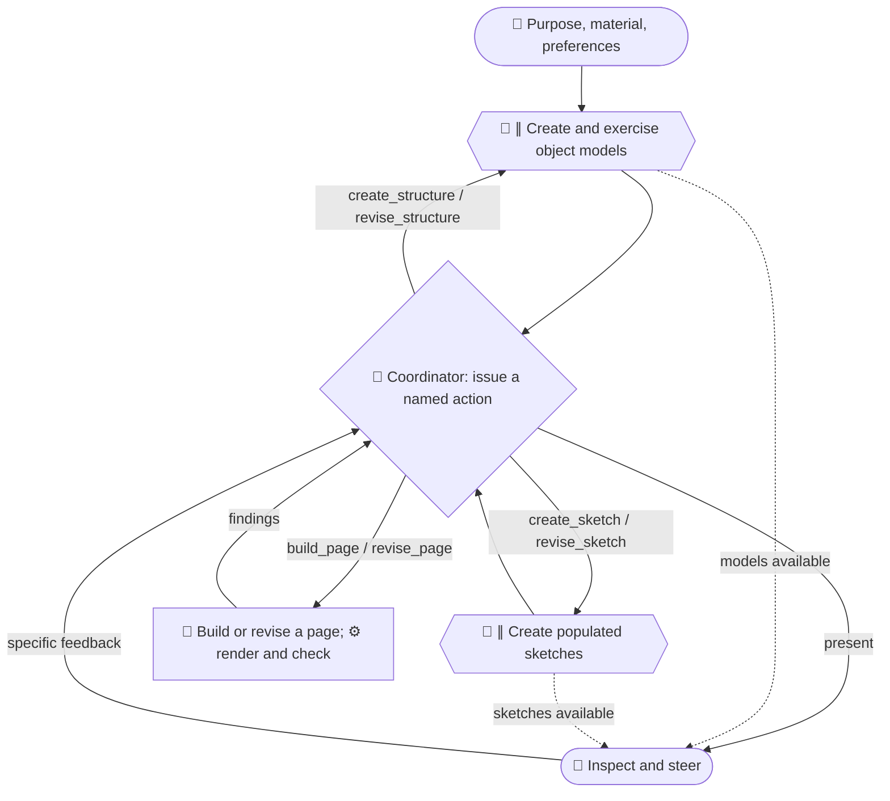

# Action contracts

The coordinator issues named operations. A person can request the same operation
through chat or a future control surface. The first version uses files and the
available model, browser and shell tools; the validator checks the resulting
record and does not dispatch model work.

## Flow

Emoji identify actors. Hexagons with `∥` identify parallel creation. Dotted arrows
make intermediate artifacts inspectable. Return arrows address selected
instances and produce new versions.



Routine checking can remain inside an activity. Use a separate tester call when
its independence or distinct output helps the task. Genuine recursion gives a
subview its own brief and allowance, runs these same actions, then returns a
component and its provenance to the parent. Begin with local revisions and add
subtasks only when their concrete purpose warrants the extra coordination.

## Operations

| Operation | Target | Consumed inputs and required result |
|---|---|---|
| `create_structure` | `brief` | Source and brief. New structure with a provisional scope, consequential relationships, worked cases and evidence distinctions. Name the organizing idea being tried. |
| `revise_structure` | Structure version | Target and relevant source. New structure version with `revises` naming the target. Preserve cases and explain the change. |
| `create_sketch` | Structure version | Target, source, brief and style resources. New populated sketch whose `parents` include the target. Name the presentation idea. |
| `revise_sketch` | Sketch version | Target and the model version now used. New sketch version with `revises` naming the target and `parents` naming the actual model version. |
| `build_page` | Sketch version | Target, its model, source and style resources. New runnable page whose `parents` include the sketch. |
| `revise_page` | Page version | Target and current dependencies. New page version with `revises` naming the target and `parents` naming the versions now consumed. |
| `run_check` | Any artifact version | Named criterion and check procedure. Add a check result with observations and limitations. Save substantial reports as files. |
| `park` | Any artifact version | Record why the branch receives no further work now. Retain its files and descendants. |
| `resume` | Any artifact version | Record the new reason to reconsider the branch. Check its dependencies before advancing it. |
| `present` | Any artifact version | Make the artifact and its relevant alternatives reachable by the person. Update `presented` to the current handoff selection; older presentations remain in action history. |

A new candidate starts another branch. A revision creates a separately stored
version in the same branch. Revising a model does not require rebuilding every
candidate: inspect the views that consume the superseded version, then record
which views need revision or remain valid under a named compatibility check.

## Run record

Keep coordination metadata in `run.json`. Artifact contents remain free JSON,
HTML or another appropriate format. Paths are relative to the run folder. IDs
are stable within a run; revision IDs such as `structure-a-v2` identify versions.

```json
{
  "brief": {
    "purpose": "What the reader should understand or accomplish",
    "requested_output": "page",
    "sources": ["source.txt"],
    "preferences": ["Named visual and interaction preferences"],
    "criteria": [
      {"id": "reader-task", "procedure": "trace_task", "applies_to": ["structure", "sketch", "page"], "spec": {"question": "A concrete reader question", "expected": ["The information an answer must contain"]}},
      {"id": "render", "procedure": "render_health", "applies_to": ["page"], "spec": {"widths": [390, 1280], "max_horizontal_overflow_px": 0}}
    ]
  },
  "allowance": {"worker_jobs": 6},
  "state": "in_progress",
  "artifacts": [],
  "actions": [],
  "checks": [],
  "presented": []
}
```

The example allowance illustrates the field, not a recommended run size. Set the
allowance for the actual task and record any later change. Count creator
assignments and separately assigned tester requests as worker jobs, including
assignments executed inline. Coordination and deterministic scripts consume
zero worker jobs. Record elapsed time or
provider usage separately when observable; do not invent token or API counts.

Each artifact has `id`, `kind` (`structure`, `sketch`, `page` or `report`),
`path`, `parents` (current content dependencies), and optional `revises`.
The revision target belongs in `revises`; action `inputs` retain all versions
consulted while doing the work.
Keep revision ancestry separate from dependency ancestry: a new sketch can
revise an old sketch while consuming the new model version.
Reports remain historical evidence about their named targets. A newer page
requires checks bound to its own version; the earlier report stays inspectable.

Each action has this shape:

```json
{
  "id": "action-a",
  "by": "bot",
  "op": "revise_structure",
  "target": "structure-a-v1",
  "inputs": ["structure-a-v1"],
  "reason": "The worked case needs a relationship absent from the model",
  "expected_change": "Name the specific relationship and what the reader can trace",
  "verify": ["reader-task"],
  "allowance": {"worker_jobs": 1},
  "used": {"worker_jobs": 0},
  "status": "planned",
  "outputs": [],
  "prompt": "requests/action-a.txt",
  "response": "responses/action-a.txt"
}
```

`by` is `person`, `bot` or `script`. `status` is `planned`, `running`,
`completed`, `failed` or `cancelled`. Creator actions preserve exact requests
and original responses. Set `used` from the actual worker job count and link the
produced artifact IDs in `outputs`. Failed attempts remain in the record.
`by` identifies the executor. When the person requests an operation performed
by a bot, use `by: bot` and optional `requested_by: person`.

Each check has `artifact`, `criterion`, `status` (`pass`, `fail` or `unknown`),
and a nonempty `evidence` list. A `run_check` result also names its issuing
`action` ID. A passing `person_review` names `by: person` and preserves the
person's response. Record observed facts, report paths and scope of
coverage. For an unknown result, state what prevented the check. A compatibility
check additionally names `compatible_with`, the newer model or sketch version.
The check must compare the affected view with that replacement and record the
relationships or content inspected. Such a check covers that direct dependency;
it cannot excuse an older dependency further down the chain.

`state` is `in_progress` or `ready_for_review`. A ready run presents the requested
artifact kind, accounts for its applicable criteria, and resolves dependency
warnings through revision or recorded compatibility checks. A failed or unknown
criterion can be handed over explicitly; record those unresolved findings in
`handoff.unresolved` and the reason for handing over in `handoff.reason`.

Parked branch IDs are recorded in optional `parked`; actions are ordered and the
last completed `park` or `resume` for an artifact determines its current state.
Preserve requests, models,
sketches, pages and check files at distinct paths so earlier versions remain
available. Provide links to intermediate artifacts while the run continues;
these links are opportunities to inspect and steer, not mandatory approval stops.
